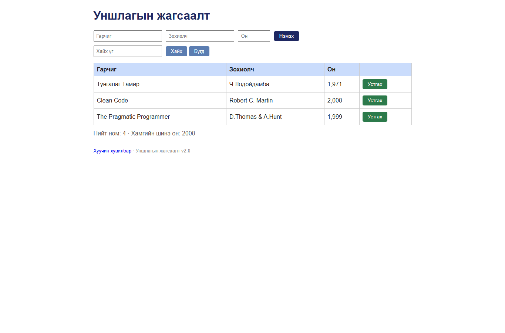

# BUG-03: “Устгах” товч улаан биш ногоон байна

Орчин: Уншлагын жагсаалт v2.0, Google Chrome 155.0.8059.80, Windows 11, 2026-10-20

Урьдчилсан нөхцөл: `node app.js`-ийг шинээр асаасан (анхны 3 ном).

## Дахин гаргах алхам

1. `http://localhost:3000` хуудсыг нээнэ.
2. Аль нэг “Устгах” товчны өнгийг харна.

Хүлээгдэж байсан: Аюултай үйлдлийн “Устгах” товч улаан байна.

Бодит үр дүн: Товч ногоон (`rgb(44, 122, 75)`) байна.

Ноцтой байдал: **Minor** — устгах үйлдлийн харааны анхааруулга буруу байна.

Хавсралт: 

Олдсон аялал: Supermodel (Tourist district)
