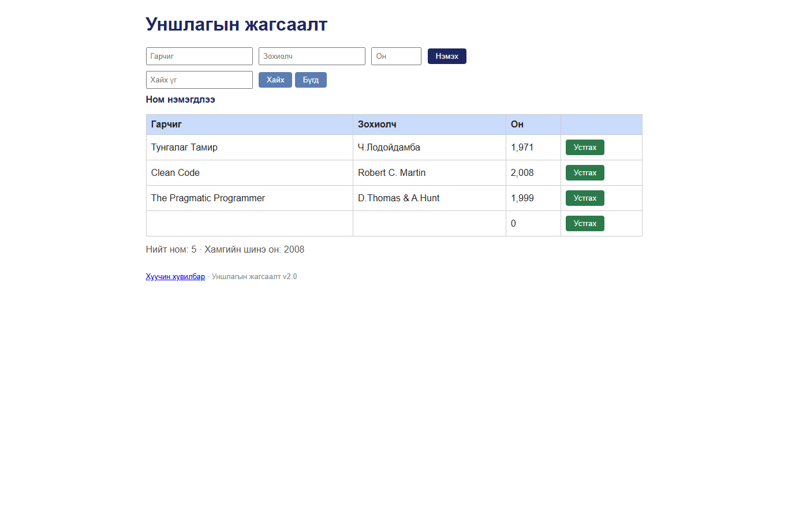

# BUG-05: Шаардлагатай талбарууд хоосон байхад ном нэмэгдэнэ

Орчин: Уншлагын жагсаалт v2.0, Google Chrome 155.0.8059.80, Windows 11, 2026-10-20

Урьдчилсан нөхцөл: `node app.js`-ийг шинээр асаасан (анхны 3 ном).

## Дахин гаргах алхам

1. `http://localhost:3000` хуудсыг нээнэ.
2. Гарчиг, Зохиолч, Он талбарыг хоосон үлдээнэ.
3. “Нэмэx” товчийг дарна.

Хүлээгдэж байсан: Ном нэмэгдэхгүй, ойлгомжтой алдааны мессеж харагдана.

Бодит үр дүн: Хоосон гарчиг, зохиолч, `0` онтой мөр нэмэгдэж “Ном нэмэгдлээ” гэж харагдана. API нь `{}`, `[]`, `false` болон body-гүй хүсэлтийг мөн хүлээн авдаг.

Ноцтой байдал: **Major** — шаардлагатай өгөгдөлгүй ном хадгалагдаж байна.

Хавсралт: 

Олдсон аялал: Saboteur (Seedy district)
