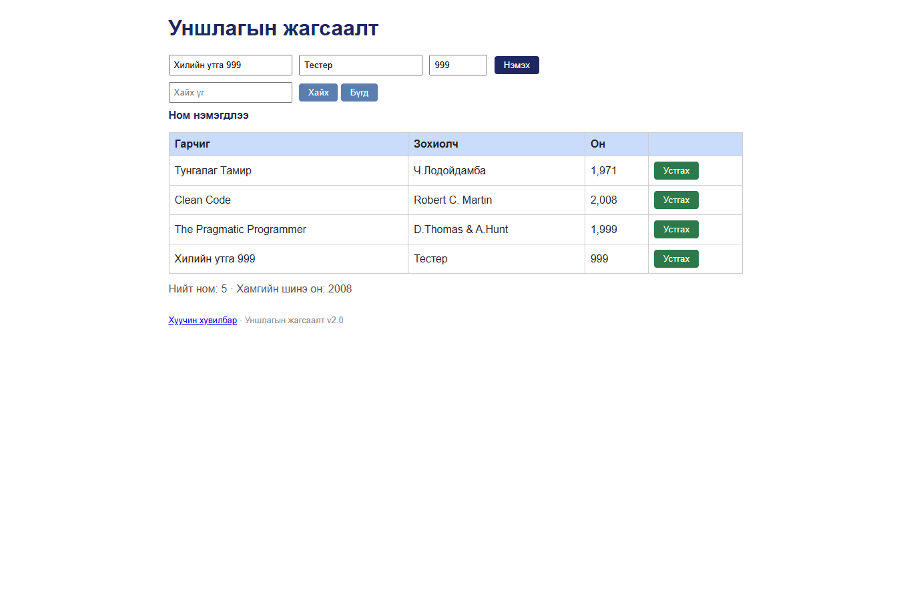

# BUG-06: Хүчингүй онуудыг шалгалгүй нэмдэг

Орчин: Уншлагын жагсаалт v2.0, Google Chrome 155.0.8059.80, Windows 11, 2026-10-20

Урьдчилсан нөхцөл: `node app.js`-ийг шинээр асаасан (анхны 3 ном).

## Дахин гаргах алхам

1. `http://localhost:3000` хуудсыг нээнэ.
2. Гарчигт `Хилийн утга 999`, зохиолчид `Тестер`, онд `999` оруулна.
3. “Нэмэx” товчийг дарна.

Хүлээгдэж байсан: Он 1000-2100 хоорондох бүхэл тоо биш тул ном нэмэгдэхгүй, алдааны мессеж гарна.

Бодит үр дүн: `999` онтой ном нэмэгдэнэ. `2101`, `1999.5`, `хоёр мянга` утгууд мөн зөвшөөрөгдөж, текст он хүснэгтэд `NaN` болдог.

Ноцтой байдал: **Major** — хүчингүй он үндсэн өгөгдөлд хадгалагдаж байна.

Хавсралт: 

Олдсон аялал: Saboteur (Seedy district)
