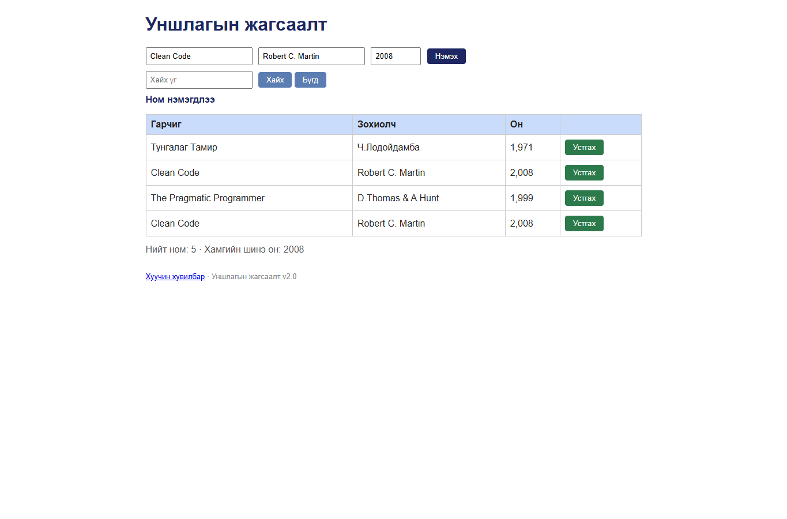

# BUG-07: Ижил гарчиг, зохиолчтой ном давхар нэмэгдэнэ

Орчин: Уншлагын жагсаалт v2.0, Google Chrome 155.0.8059.80, Windows 11, 2026-10-20

Урьдчилсан нөхцөл: `node app.js`-ийг шинээр асаасан (анхны 3 ном).

## Дахин гаргах алхам

1. `http://localhost:3000` хуудсыг нээнэ.
2. Гарчигт `Clean Code`, зохиолчид `Robert C. Martin`, онд `2008` оруулна.
3. “Нэмэx” товчийг дарна.

Хүлээгдэж байсан: Ижил гарчиг, зохиолчтой ном нэмэгдэхгүй, алдааны мессеж гарна.

Бодит үр дүн: Хоёр ижил `Clean Code` мөр харагдаж “Ном нэмэгдлээ” гэж гарна. Өөр он ашиглах болон API-аар илгээхэд ч давхардал зөвшөөрөгдөнө.

Ноцтой байдал: **Major** — жагсаалтын давхардал өгөгдлийн бүрэн бүтэн байдлыг алдагдуулна.

Хавсралт: 

Олдсон аялал: Saboteur (Seedy district)
