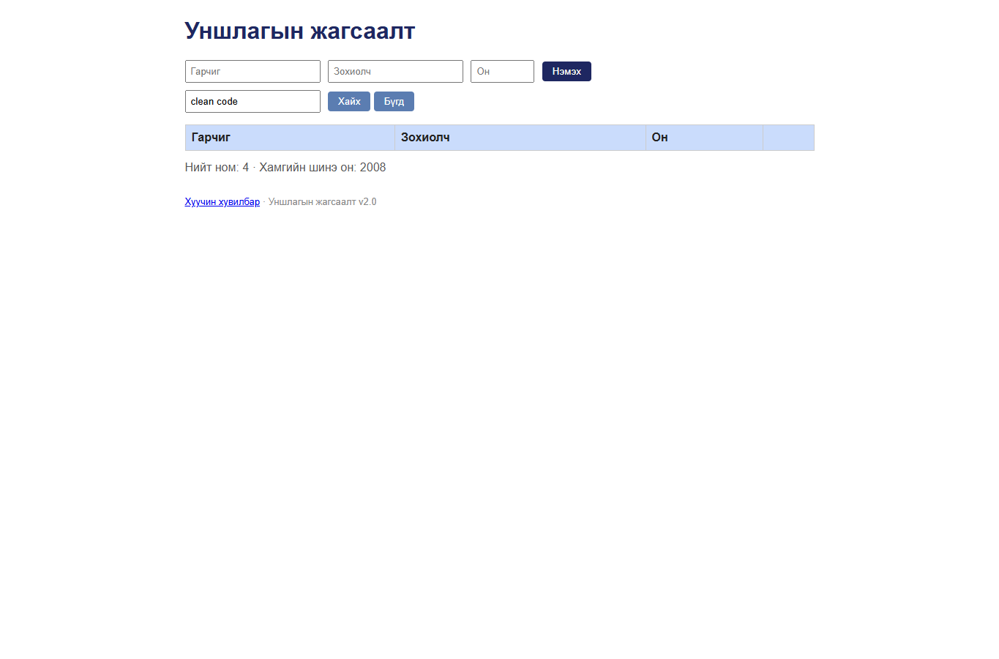

# BUG-08: Хайлт том, жижиг үсэг ялгадаг

Орчин: Уншлагын жагсаалт v2.0, Google Chrome 155.0.8059.80, Windows 11, 2026-10-20

Урьдчилсан нөхцөл: `node app.js`-ийг шинээр асаасан (анхны 3 ном).

## Дахин гаргах алхам

1. `http://localhost:3000` хуудсыг нээнэ.
2. Хайх талбарт `clean code` оруулна.
3. “Хайх” товчийг дарна.

Хүлээгдэж байсан: Том, жижиг үсэг ялгахгүй тул `Clean Code` мөр олдоно.

Бодит үр дүн: Хүснэгт 0 мөр харуулна. Зохиолч болон кирилл нэрийн жижиг үсгийн хайлт мөн олдохгүй.

Ноцтой байдал: **Major** — зөв ном байгаа ч үндсэн хайлтаар олдохгүй байна.

Хавсралт: 

Олдсон аялал: Supermodel (Tourist district)
