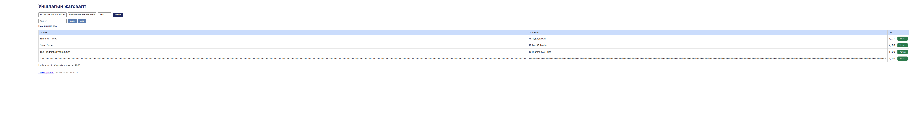

# BUG-10: Урт оролт хүснэгтийг дэлгэцээс хэт өргөн болгоно

Орчин: Уншлагын жагсаалт v2.0, Google Chrome 155.0.8059.80, Windows 11, 2026-10-20

Урьдчилсан нөхцөл: `node app.js`-ийг шинээр асаасан (анхны 3 ном).

## Дахин гаргах алхам

1. `http://localhost:3000` хуудсыг 1365 px өргөн цонхонд нээнэ.
2. Гарчигт 300 ширхэг `A`, зохиолчид 220 ширхэг `B`, онд `2000` оруулна.
3. “Нэмэx” товчийг дарна.

Хүлээгдэж байсан: Урт оролт мөр дамжин эсвэл хязгаарлагдаж, хүснэгт дэлгэцийн өргөнийг эвдэхгүй.

Бодит үр дүн: Хүснэгт 5725 px, хуудас 5978 px өргөн болж ихэнх агуулга дэлгэцээс гарна.

Ноцтой байдал: **Major** — жагсаалт ашиглах боломжгүй хэмжээнд хэвтээ хальж байна.

Хавсралт: 

Олдсон аялал: Supermodel (Tourist district)
