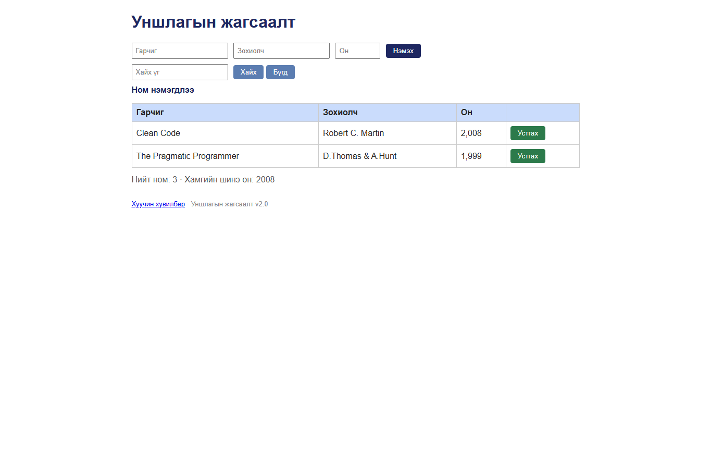

# BUG-11: Ном устгасны дараа нэмсэн тухай буруу мессеж гарна

Орчин: Уншлагын жагсаалт v2.0, Google Chrome 155.0.8059.80, Windows 11, 2026-10-20

Урьдчилсан нөхцөл: `node app.js`-ийг шинээр асаасан (анхны 3 ном).

## Дахин гаргах алхам

1. `http://localhost:3000` хуудсыг нээнэ.
2. Эхний мөрийн “Устгах” товчийг дарна.

Хүлээгдэж байсан: Мессеж ном устсан тухай зөв мэдээлнэ.

Бодит үр дүн: Мөр устсан ч “Ном нэмэгдлээ” гэсэн мессеж гарна.

Ноцтой байдал: **Minor** — үйлдэл хийгдсэн ч хэрэглэгчид эсрэг утгатай мэдээлэл өгч байна.

Хавсралт: 

Олдсон аялал: Supermodel (Tourist district)
