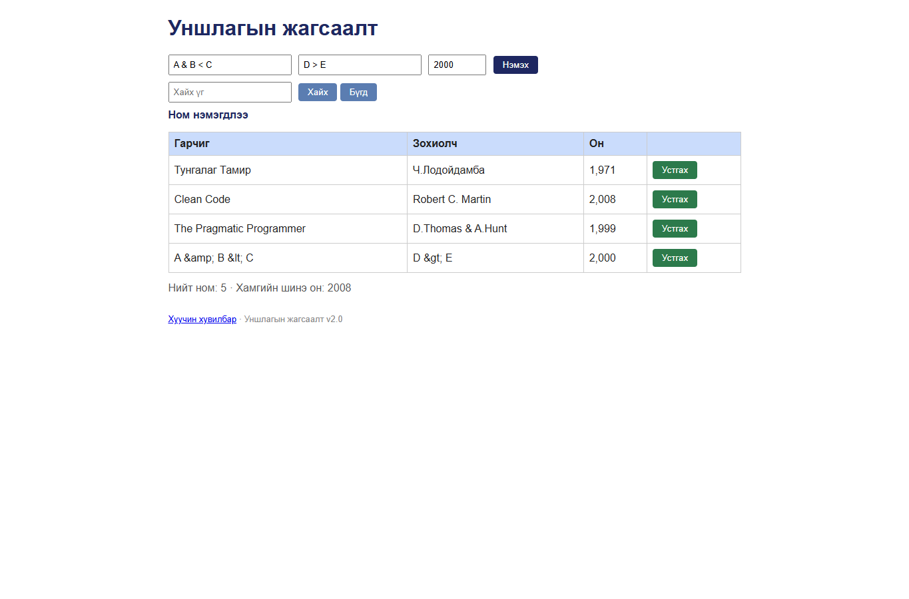

# BUG-14: HTML тусгай тэмдэгтүүд өгөгдөл хэлбэрээр entity болж хадгалагдана

Орчин: Уншлагын жагсаалт v2.0, Google Chrome 155.0.8059.80, Windows 11, 2026-10-20

Урьдчилсан нөхцөл: `node app.js`-ийг шинээр асаасан (анхны 3 ном).

## Дахин гаргах алхам

1. `http://localhost:3000` хуудсыг нээнэ.
2. Гарчигт `A & B < C`, зохиолчид `D > E`, онд `2000` оруулна.
3. “Нэмэx” товчийг дарна.
4. `A & B` гэж хайна.

Хүлээгдэж байсан: Оруулсан текст өөрчлөгдөхгүй харагдаж, эх утгаар хайхад олдоно.

Бодит үр дүн: `A &amp; B &lt; C`, `D &gt; E` гэж харагдаж, API GET-д мөн entity хэлбэрээр хадгалагдсан байна. `A & B` хайлт 0 мөр буцаана.

Ноцтой байдал: **Major** — хэрэглэгчийн өгөгдөл өөрчлөгдөж, дараагийн хайлтын урсгал эвдэрнэ.

Хавсралт: 

Олдсон аялал: Charter-аас гадуурх Fed-Ex (Business district)
